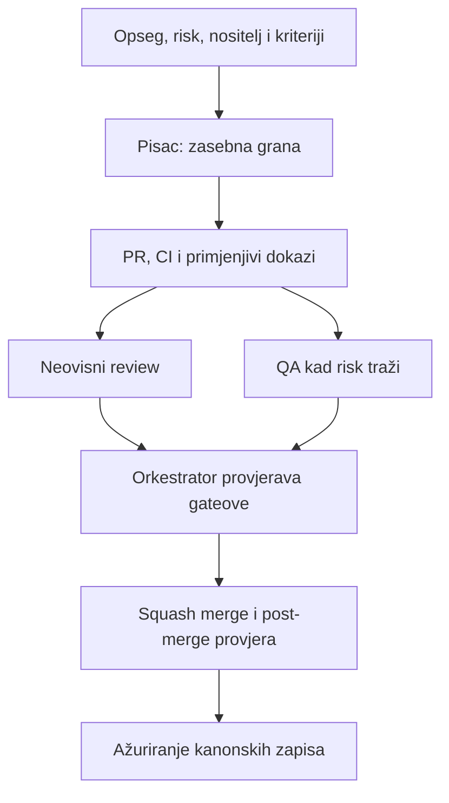

# Ductus Engineering System v1

Verzija 1.1 · 7. 10. 2026. · Odgovorna osoba: Daniel Rišavi

Ovaj dokument definira kako AI tim razvija Ductus. Ne mijenja proizvodni Ustav, `PRODUCT.md` ni tehničku arhitekturu. Cilj je povećati brzinu bez gubitka neovisnog pregleda, testabilnosti i jasnog vlasništva.

## 1. Načelo

Ductus nije tvornica koda. Sustav optimizira za:

1. ispravnost;
2. povjerenje i sigurnost;
3. dokazivost odluka;
4. male, reverzibilne promjene;
5. brzinu tek nakon prva četiri uvjeta.

Normalno rade **tri stalna writera**: Backend, Frontend i Platforma. Četvrti writer dopušten je privremeno samo za potpuno neovisan zadatak. Više od četiri istodobna writera nije dopušteno.

## 2. Stalne uloge

| Uloga | Piše proizvodni kod | Odgovornost |
| --- | --- | --- |
| Orkestrator / Tech Lead | ne | red rada, scope, ovisnosti, risk, review, merge, stanje |
| Backend + Data | da | baza, identity, authz, evidence, submission, worker, projekcije |
| Frontend + Editor | da | Tiptap/ProseMirror, Dexie, sync, recovery, studentsko i nastavničko sučelje |
| Platform / SRE | da | CI, Docker, deploy, migracijski tooling, backup, restore, observability, supply chain |
| Product + UX + Design | ne po defaultu | korisnički tokovi, copy, dizajn, evaluacija novih funkcija |
| QA / Adversarial | samo testove i testne alate | specifikacijski, E2E, race, offline, chaos, browser i regression testovi |
| Independent Reviewer / Security | ne | pregled PR-a neovisno o autoru |
| Bug Hunter / Product Critic | ne | pokušava razbiti main/staging i otvara reproducibilne bugove |

Privremene uloge: Architecture/Performance Auditor i Privacy/Legal/Pilot Auditor.

## 3. Odvajanje odgovornosti

- Product/UX ne implementira vlastiti prijedlog. Otvara issue.
- Bug Hunter ne popravlja vlastiti bug. Otvara issue.
- Autor PR-a ne smije biti njegov neovisni reviewer.
- QA ne smije proglasiti vlastitu implementaciju adversarialno provjerenom.
- Orkestrator ne piše proizvodni kod.
- Backend i Frontend ne mijenjaju Platformine workflowe bez koordinacije.
- Platforma ne potvrđuje sama da sigurnosni gate koji je napisala stvarno hvata kvar; QA ga mora pokušati srušiti.

## 4. Runtime identitet

Svaki agent ima identitet:

```
<runtime>:<slot>:<role>
```

Primjeri:

```
claude:a:backend
claude:b:frontend
codex:a:platforma
chatgpt:b:reviewer
claude:c:qa
```

GitHub korisničko ime nije agent identitet jer više agenata može koristiti isti GitHub račun.

## 5. Risk razine

Svaki PR mora imati jednu razinu.

### low

Dokumentacija, copy bez promjene značenja, preimenovanja, jednostavna konfiguracija, mali dependency update bez runtime promjene.

Iznimka: PR koji dira putanje ili zapise iz D-97 (`docs/DECISIONS.md`), tj. pravila o tome tko smije pisati, pregledavati, spajati ili zaobići provjeru, nije `low` ni kad je samo dokumentacija; otvara se kao `critical` kad dira putanju iz D-97, a kao `standard` ili viši kad dira samo `docs/DECISIONS.md` ("Automatski risk floor" niže), i spaja tek na Danielovu naredbu.

Gate:
- CI;
- Dependency review kad je primjenjivo;
- neovisni review **nije obavezan** samo kad PR mijenja isključivo datoteke s popisa dozvoljenog: `*.md` izravno u `docs/` (bez podmapa) i korijenski `README.md` (D-189, sužen na #971 po vlasnikovoj opciji A; `isLowDocExemptPath` u `scripts/engineering/protected-paths.mjs`). S popisa su uvijek isključeni `docs/DECISIONS.md`, D-97 putanje, datoteke s uputama za agente (`CLAUDE*.md`, `AGENTS*.md`, `GEMINI*.md`, `copilot-instructions.md`, `*.instructions.md`) i svaka putanja sa segmentom koji počinje točkom (npr. `docs/.claude/skills/`), jer ih agent učitava kao upute. Preimenovanje se broji pod oba imena. Izuzeće vrijedi samo kad je grana PR-a u ovom repou (`head.repo.full_name` jednak `base.repo.full_name`); PR iz forka ga nikad ne dobiva (#971);
- svaki drugi `low` PR (dokument u podmapi ili izvan `docs/`, konfiguracija, `public/`, JSON, bilo koja datoteka izvan popisa) i dalje traži jedan neovisni review ili eksplicitni Owner Override (#971: dodan `next.config.js` zasjenjuje `next.config.ts` i skida sigurnosna zaglavlja).

### standard

Frontend ponašanje, editor, adapteri, API bez novih ovlasti, migracije bez security granice, CI promjene, portovi, refaktori.

Gate:
- CI;
- Dependency review;
- jedan neovisni reviewer na aktualnom headu;
- dodatni QA kad Orkestrator procijeni da je promjena sklona race/offline/browser regresiji.

### critical

Identity, authz, RLS, pgTAP matrica, evidence, hash/JCS, potpisi, KMS, session management, submission, rekonstrukcija, retention, backup/restore, migracije koje mijenjaju ovlasti, PRODUCT §5 ili druga trust granica.

Gate:
- svi standard gateovi;
- neovisni reviewer;
- zaseban QA/adversarial PASS na aktualnom headu;
- sintetički staging prolaz kad BACKEND §6 točka 12 vrijedi;
- pravila rada za `critical` PR iz §14.

Izuzeće od QA-e (vlasnik, 11. 10. 2026., #87, `issuecomment-6112538306` i `6112555187`): `critical` PR koji mijenja samo testove ili samo dokumente, uključivo dokumente koji određuju gate i pravila rada te testove gatea u `scripts/engineering/`, ne traži zaseban QA PASS. **Izuzeće od reviewa (D-189, 28. 10. 2026.):** `critical` ili `standard` PR koji samo **dodaje** nove testne datoteke (svaka datoteka `status: added`, bez preimenovanja) također ne traži neovisni review. Za to izuzeće vrijedi popis dozvoljenog (sužen na #971 po vlasnikovoj opciji A; `isNewTestExempt` u `scripts/engineering/protected-paths.mjs`): nova datoteka `*.test.ts` ili `*.spec.ts` pod `src/` (osim `src/app/` i `src/pages/`) ili pod `tests/unit/`, bez segmenta koji počinje točkom i izvan D-97 putanja. Ništa drugo nije izuzeto: Next.js od testnog imena u `src/app/` ili `src/pages/` gradi stranicu ili rutu (`src/pages/api/x.test.ts` odgovara na `/api/x.test` i ruši build, #971), a `e2e/`, `tests/e2e/`, `tests/integration/`, `db/tests/`, pomoćne datoteke, `*.tsx`, `*.js` i sve ostale mape ostaju pod reviewom. Nova pomoćna datoteka u testnoj mapi može zasjeniti postojeću (uvoz bez nastavka, #971), a pgTAP datoteke dijele bazu i izvode se abecedno, pa nova može promijeniti što kasnije provjeravaju. `low` PR koji samo dodaje testove nema ovo izuzeće, jer D-189 (2) navodi samo `standard` i `critical`; risk floor ionako ne dopušta `low` za `src/` i `tests/`. Izuzeće vrijedi samo kad je grana PR-a u ovom repou: PR iz forka uvijek traži review, a `critical` i vlasnikovu naredbu (#971). PR koji mijenja, briše ili preimenuje postojeći test i dalje traži review, jer test može biti jedina provedba čuvara. Docs-only ostaje pod `low` pravilom. Izuzeće od reviewa mijenja put spajanja: `critical` PR sa samo novim testovima s ovog popisa, s granom u ovom repou i bez D-97, dobiva zelen „Merge authorization” bez vlasnikove naredbe (treći slučaj u §10). Izuzeće od QA-e put spajanja ne mijenja: PR koji dira putanju iz D-97 spaja se po `docs/ORKESTRATOR.md` §4 (vlasnikova naredba s brojem PR-a, a noću i noćni prozor kad je uključen), ostali QA-izuzeti PR-ovi kao i dosad; `critical` QA-izuzet PR s datotekama samo s popisa dozvoljenog D-196 (7), s granom u ovom repou i s review PASS-om kroz App ne traži vlasnikovu naredbu (D-196 (6) i (7), §10). Gate provodi pravilo od #275 (`qaExemption` u `scripts/engineering/protected-paths.mjs`) i gleda samo popis datoteka, nikad tijelo PR-a. "Testovi" su sve datoteke pod `tests/`, `e2e/` ili `db/tests/` (i pomoćne datoteke, fixturei i postavke u tim mapama, bez obzira na nastavak) te `*.test.*` i `*.spec.*` u js/ts varijantama; "dokumenti" su sve `*.md` datoteke, uključivo `.claude/agents/*.md` i `SKILL.md`. Datoteka `*.md` pod `tests/`, `e2e/` ili `db/tests/` broji se i kao test i kao dokument, pa ne kvari izuzeće ni PR-u sa samo testovima ni PR-u sa samo dokumentima. PR koji mijenja i testove i dokumente nije izuzet, kao ni PR koji uz njih mijenja bilo koju drugu datoteku (Python testovi i konfiguracije testova izvan tih mapa nisu "testovi" u ovom smislu). Preimenovanje se broji pod starim i novim imenom.

Za posebno osjetljiv auth/RLS/crypto PR Orkestrator može tražiti drugog reviewera iz drugog providera.

### Sažetak razina strogosti

| Razina | Review | QA | Primjer |
| --- | --- | --- | --- |
| **critical** | Da (osim samo novih testova) | Da (osim test-only / docs-only) | Auth, evidencija, gate, D-97 |
| **standard** | Da (osim samo novih testova) | Po potrebi | Editor, API bez novih ovlasti, refaktor |
| **low, samo dokumenti** | Ne | Ne | `*.md` izvan `public/`, `app/`, `src/` i D-97, bez `CLAUDE.md` i `AGENTS.md` u bilo kojoj mapi |
| **low, ostalo** | Da | Ne | Copy u kodu, jednostavna konfiguracija, `CLAUDE.md` ili `AGENTS.md` u podmapi |
| **standard ili critical, samo novi testovi** | Ne | Ne | Samo nove `*.test.*` / `*.spec.*` datoteke pod `src/` (bez `src/app/` i `src/pages/`), `tests/` ili `e2e/`, izvan D-97 |
| **izmjena postojećih testova** | Da | Ne | Izmijenjen, obrisan ili preimenovan test |

Negativni verdikt (FAIL / BLOCK) i dalje blokira bez obzira na razinu. D-97 putanje i `docs/DECISIONS.md` ostaju pod owner command pravilom. "Ne" u stupcu Review vrijedi samo za granu u ovom repou; PR iz forka uvijek traži review (#971).

### Auto-merge za low i test-only

Gate objavljuje zelen status **Auto-merge eligible** samo za PR kojem isto pravilo kao u gateu (`reviewExemption` u `scripts/engineering/review-gate-core.mjs`) skida review: `Risk: low` sa samo dokumentima iz §5 ili `Risk: standard` ili `critical` koji samo dodaje nove testove iz §5, bez D-97 putanja i s granom u ovom repou. Mergify pravilo koje je takav PR samo stavljalo u queue isključeno je od F-165 dok vlasnik ne odluči o D-189 (5): i taj PR u queue ulazi samo naredbom `@Mergifyio queue`. Ostali PR-ovi, uključivo PR iz forka i `low` PR s novim testovima, i dalje traže ručnu naredbu `@Mergifyio queue`, a uz to i Owner-Command kad im „Merge authorization” nije zelen (§10).

CI profil `tests` čita isti popis dozvoljenog kao izuzeće za nove testove (`isNewTestExempt`), suženo na datoteke koje izvodi projekt `unit` (`*.test.ts`, bez `*.property.test.ts` i `*.integration.test.ts`; `classifyDiff` u `scripts/engineering/ci-docs-scope.mjs`). Test pod `src/app/`, `src/pages/`, `app/` ili `pages/` i svaka druga putanja izvan popisa daju profil `full`, pa se build izvodi. Profili `docs` i `tests` preskaču stack, bazu, preglednik, property testove, demo i fake-OIDC testove te `pnpm build`; lint, typecheck, `test:unit`, testovi engineering sustava i sigurnosni skeneri ostaju.


### Automatski risk floor

CI i Engineering review gate ponovno računaju minimalnu razinu prema promijenjenim putanjama:
- obični docs-only može biti `low`;
- runtime kod, infra, izvršne skripte i `docs/DECISIONS.md` (zapisi iz D-97 ne mogu se prepoznati po putanji) najmanje `standard`;
- identity/auth/authz/OIDC/login/evidence/ingest/submission/retention/crypto/signing/forensics/session/JCS/signature/replay, request middleware, sve `app/api/**` trust granice koje sadrže te segmente, security migracije, pgTAP matrica, forbidden-terms gate, `PRODUCT.md`, `CLAUDE.md`, `AGENTS.md`, `ENGINEERING_SYSTEM.md`, CODEOWNERS i **svaki GitHub workflow** najmanje `critical`;
- najmanje `critical` je i svaka putanja iz D-97 (`D97_PATHS` u `scripts/engineering/protected-paths.mjs`: cijeli `.github/`, `.claude/`, `.agents/`, `scripts/engineering/`, `scripts/hooks/`, `scripts/orchestrator/`, `plugins/ductura-engineering/`, `lefthook.yml` i nabrojeni dokumenti pravila) te `STATE.md`, `.worktreeinclude`, `.cc-safety-net/`, `osv-scanner.toml`, `plugins/`, `db/migrations/` (sve migracije), `db/local/`, `src/server/db/`, cijeli `tests/`, `vitest.config.ts`, `playwright.config.ts`, `playwright.login.config.ts` i `test-output.ts` (učitavaju se pri pokretanju testova) te `e2e/auth.spec.ts`, jedini test da produkcijski build odbija lažnog pružatelja (D-09). Test u `tests/` može biti jedina provedba čuvara, pa nosi razinu čuvara; nova datoteka u `tests/` zato je `critical` bez dopune popisa.

Usporedba putanja ne ovisi o velikim i malim slovima, kosim crtama ni prefiksu `./`; preimenovana datoteka broji se pod oba imena, a obrisana pod svojim. Ako GitHub ne vrati cijeli popis promijenjenih datoteka, gate pada zatvoreno (`failure`). Poruka o preniskom `Risk` u statusu je nepromjenjiv tekst bez imena datoteka; imena su u logu CI posla.

Auto-merge: dok je na PR-u uključen auto-merge, a promijenjene datoteke traže Danielovu naredbu (putanje iz D-97 ili `docs/DECISIONS.md`), gate vraća `pending` bez obzira na review i QA. Hook `scripts/hooks/pr-auto-merge.mjs` uključuje auto-merge samo kad je deklarirani i izračunati rizik `low`, nema takvih putanja i popis promijenjenih datoteka se mogao pročitati. Granica: hook čita lokalni `git diff` prema `origin/main`, pa je strojna provjera gate, ne hook; sesija s tokenom može i dalje ručno spojiti PR, što gate ne sprječava (D-97 ostaje governance pravilo).

Heuristika je samo donja granica. Orkestrator smije podići risk; agent ga ne smije spustiti ispod semantičke ozbiljnosti promjene. Edit PR bodyja na istom headu ponovno pokreće trusted gate, pa promjena `Risk`, `Agent` ili `Task` ne nasljeđuje stari zeleni status.

## 6. PR metadata

Svaki PR mora sadržavati:

```
Agent: <runtime>:<slot>:<role>
Risk: low | standard | critical
Task: <ID ili kratki identifikator>
```

Review komentar je zaseban kanonski komentar. **Prva neprazna linija mora biti `Agent-Review:`**; primjer u code blocku ili tekst nakon preambule ne vrijedi kao verdict.

```
Agent-Review: <runtime>:<slot>:reviewer
Review-Head: <40-znamenkasti SHA>
Review-Verdict: PASS | FAIL | BLOCK
```

Verdict se ključa po `GitHub App + normalizirani runtime:slot`. Claude ostaje `claude:<slot>`; `codex` i `chatgpt`, jer dolaze kroz isti ChatGPT/Codex GitHub App, za usporedbu autora normaliziraju se u `openai:<slot>`. Za isti takav identitet vrijedi samo njegov najnoviji verdict na aktualnom headu. Aktualni `FAIL` ili `BLOCK` bilo kojeg valjanog neovisnog review identiteta drži gate blokiranim i ne može ga pregaziti PASS druge sesije istog Appa. Autor i reviewer moraju imati različit deklarirani/normalizirani principal. Sesija koja je napisala plan napada za zadatak (`docs/ORKESTRATOR.md` §8) ne daje review ni QA verdikt na PR-u tog zadatka (zabranu QA verdikta zapisao je vlasnik u DAN-122, a proširenje na review potvrdio ga je vlasnik: https://github.com/danielrisavi77-create/Ductus/pull/165#issuecomment-6100851850); isto vrijedi za pisca patcha koji je autor PR-a uz sesiju koja ga commita (`docs/ORKESTRATOR.md` §8); to je governance pravilo koje gate strojno ne provjerava.

Za `critical` PR QA komentar je također zaseban kanonski komentar čija prva neprazna linija mora biti `QA-Agent:`:

```
QA-Agent: <runtime>:<slot>:qa
QA-Head: <40-znamenkasti SHA>
QA-Verdict: PASS | FAIL | BLOCK
QA-Scope: <što je adversarialno provjereno>
```

Za `critical` PR reviewer i QA moraju biti strojno različiti po autentificiranom GitHub Appu koji je objavio komentar, osim uz uvjete neovisnog Codex para (D-158), kvotnog fallbacka ili druge Claude sesije (D-139) opisane niže. To ograničenje vrijedi za **PASS**. Međutim, svaki valjani ne-autorski QA `FAIL` ili `BLOCK` drži gate blokiranim bez obzira na to je li isti App već dao reviewer PASS. Trenutno se prihvaća Claude App (`claude`) za `claude:*:reviewer|qa`, ChatGPT/Codex App (`chatgpt-codex-connector`) za `chatgpt:*|codex:*`, te Grok by xAI App (`grok-by-xai`) za `grok:*`. Runtime `grok:*` je podržan i za gate. Stvarni Grok komentar potvrđen je kao GitHub App `grok-by-xai` (Grok by xAI), pa se prihvaća samo mapping `grok-by-xai → grok`. Jedan isti GitHub App ne može zadovoljiti i review i QA samo promjenom deklariranog runtimea. **Grok CLI (D-162).** Review ili QA koji vlasnik pokrene iz Grok CLI-ja (`scripts/grok-review.ps1`) objavljuje se s vlasnikova računa, bez Appa. Takav komentar broji se kao App `grok-by-xai` samo ako ga je objavio račun vlasnika repoa i sadrži redak `Review-Channel: grok-cli` izvan code blocka uz kanonska polja; status gatea tada navodi "Grok CLI review (D-162, owner account)", jer isti račun mogu koristiti i sesije s vlasnikovim tokenom; verdikt daje vlasnik, ne model. Svi ostali uvjeti ostaju (aktualni head, različit App za QA kod `critical`, autor ne reviewa sebe). Vlasnik time ne dobiva ovlast koju nema: Owner Override već postoji (§7). **Codex CLI (D-193).** Review ili QA koji orkestrator ili vlasnik pokrene iz lokalnog Codex CLI-ja (`codex exec`) objavljuje se s vlasnikova računa, bez Appa, kao Grok CLI. Takav komentar broji se kao App `chatgpt-codex-connector` (runtime `codex` ili `chatgpt`) samo ako ga je objavio račun vlasnika repoa i sadrži redak `Review-Channel: codex-cli` izvan code blocka uz kanonska polja. Komentar s oba retka (`grok-cli` i `codex-cli`) ne broji se ni kao jedan App. Status gatea tada na početku navodi "Codex CLI review (D-193, owner account)", jer isti račun koriste i sesije s vlasnikovim tokenom; verdikt formalno daje vlasnik, ne model. Svi ostali uvjeti ostaju: aktualni head i prijenos D-101, prevlast FAIL/BLOCK, autor ne reviewa sebe, a za `critical` review i QA moraju biti različiti principali (Codex par D-158/D-161 ili različit App). Dva Codex CLI komentara s različitim slotovima tako mogu dati `critical` PASS kroz Codex par; to je poznata granica, jer vlasnik isto već može Owner Overrideom. Codex CLI komentar nije dokaz Codex reviewa za D-139 ni kvotni dokaz.

### Neovisni Codex review i QA na aktualnom headu (D-158)

Kanonski review PASS i zaseban QA PASS smiju doći preko istog autentificiranog Appa `chatgpt-codex-connector` kad su oba na točno aktualnom punom SHA-u PR-a. Autor, reviewer i QA moraju imati tri različita normalizirana principala: `codex` i `chatgpt` dijele namespace `openai`, a veličina slova slota ne razlikuje principal. QA se mora razlikovati od **svakog važećeg reviewer PASS principala**, uključivo prenesene review PASS-ove. Od D-161 PASS-ovi para prenose se kroz čisto spajanje osnovne grane pod istim dokazanim uvjetima D-101 kao i ostali verdikti; bez tog dokaza vrijede samo na aktualnom headu. Postojeća prevlast `FAIL`/`BLOCK`, filtriranje autora i parser ostaju nepromijenjeni. Status imenuje „Independent Codex review and QA pair” i, kad broji prenesen PASS, head s kojeg je prenesen.

Ovaj put ne traži kvotni dokaz, `Provider-Fallback` ni model ID. Nativni PR review, Codex sažetak, potvrda „Reviewed commit” i advisory CLI nalaz nisu zamjena za kanonski review blok s principalom. Ostali cross-App, kvotni, D-139 i Owner Override putevi ostaju zasebni i nepromijenjeni.

Različiti deklarirani slotovi nisu kriptografska potvrda zasebnih procesa ili stvarne neovisnosti. Orkestrator jamči odvojene dodjele po §14–15 i `ORKESTRATOR.md` §8: QA nije autor, reviewer, njihov podagent ni pisac plana napada te ne čita reviewerov izvještaj prije vlastitog verdikta. Zeleni CI na istom headu i svi merge uvjeti ostaju obvezni. D-158 je prihvaćen Danielovom [izričitom naredbom](https://github.com/danielrisavi77-create/Ductus/pull/538#issuecomment-6301459614) i spajanjem [#538](https://github.com/danielrisavi77-create/Ductus/pull/538) 20. 10. 2026. Prije toga priprema nije bila ovlast za merge; kandidat se nije mogao legitimirati vlastitim evaluatorom.

### Fallback par modela kad drugi provider nije dostupan

Ako pretplata ili kvota za treći provider (primjerice Grok) nije dostupna, critical gate može zadovoljiti kombinacija **Fable na Claudeu** i **Astra na ChatGPT/Codexu**, u bilo kojem redoslijedu između reviewer i QA. Svaki PASS i dalje mora biti objavljen preko vlastitog autentificiranog GitHub Appa: `claude` i `chatgpt-codex-connector`. Fallback se oslanja na ta dva odvojena providera, uz korištenje ovih odabranih modela.

Radi auditabilnosti, fallback komentar bilježi model u ulozi koju je obavio, npr. `Review-Model: Fable` i `QA-Model: Astra` (ili obrnuto), uz točan runtime model ID ako ga runtime prikazuje. Bilježi se i `Provider-Fallback: <provider> — <razlog>`, primjerice `Grok — pretplata ili kvota nedostupna`. Ti su redci deklarirana governance evidencija, a ne kriptografska potvrda modela ili stanja pretplate. Automatizirani gate i dalje provjerava autentificirani App, principal, ulogu, aktualni head i verdict.

### Kvotni fallback: isti App, neovisna sesija

Dok je kvota drugog providera dokazano iskorištena, `critical` QA PASS smije doći s istog Appa kao reviewer PASS, ali samo iz neovisne sesije. Gate ga prihvaća kad su ispunjeni svi uvjeti:

1. **Strojni dokaz kvote.** Na istom PR-u postoji komentar samog iscrpljenog Appa (korisnik `<slug>[bot]`, `performed_via_github_app.slug` jednak `<slug>`) s porukom o iscrpljenoj kvoti, objavljen prije QA komentara i najviše 24 sata ranije. Deklaracija sesije nije dokaz. Trenutno je registriran samo `chatgpt-codex-connector` (poruka "reached your Codex usage limits"); obrazac za drugi App dodaje se tek nakon stvarno opažene poruke, kao kod registracije providera. Ako je dokaz stariji od 24 sata, svjež se dobiva novim pozivom tog Appa na PR-u (za Codex komentar `@codex review`). Poruka mora otvarati komentar: citat te rečenice u reviewu, bloku koda ili odgovoru nije dokaz. Dokaz prestaje vrijediti čim isti App na tom PR-u objavi kasniji komentar koji nije poruka o kvoti, kasnije uredi takav komentar (Codex uređuje jedan sažetak reviewa na mjestu) ili objavi kasniji PR review, jer tada dokazivo radi (#128). PR review ili komentar Appa bez čitljivog vremena, kao i aktivnost u istoj sekundi kao poruka o kvoti, također poništava dokaz, jer se redoslijed ne može utvrditi. Gate se ponovno računa i kad stigne PR review: workflow "Engineering gate review signal" bez ikakvih ovlasti samo prenosi taj događaj, a "Engineering review gate" se na njegov završetak (`workflow_run`) pokreće s default brancha. Granica: za PR iz forka GitHub ne navodi PR uz `workflow_run`, pa se gate preračuna tek na idući komentar ili push. Evente koji smiju pokrenuti `engineering-gate.yml` i `free-ai-pr-review.yml` određuje Actions policy repoa `engineering-gate-policy` (id 6529), koji postoji samo u postavkama repoa i mijenja ga samo vlasnik. Event koji nije na njegovu popisu završava kao startup_failure, a `workflow_run` radi tek kad ga vlasnik doda na taj popis (DAN-337). Popis je zapisan u komentaru `engineering-gate.yml`, a `scripts/engineering/engineering-workflow.test.mjs` provjerava da je svaki okidač tih dviju datoteka na njemu.
2. **Deklaracija u QA komentaru.** Kanonski QA blok sadrži `Provider-Fallback: <slug iscrpljenog Appa> — <razlog>`, npr. `Provider-Fallback: chatgpt-codex-connector — kvota iscrpljena`. Slug ne smije biti App koji objavljuje QA.
3. **Neovisan principal.** QA `runtime:slot` razlikuje se od autora i od svakog reviewera koji je dao PASS na tom headu.

Dovoljan je valjan dokaz kvote za *jedan* drugi registrirani App; ne traži se dokaz za sve ostale Appove. Primjer: Grok reviewer PASS i Grok QA PASS s `Provider-Fallback: chatgpt-codex-connector` uz valjan Codex dokaz prolaze, iako je Claude App možda dostupan. Odluka vlasnika 12. 10. 2026. (#128, `issuecomment-6123209198`); zaključava je test u `scripts/engineering/review-gate-quota-evidence.test.mjs`.

Uz strojne uvjete vrijedi governance pravilo neovisnosti: QA sesija je nova sesija s vlastitim slotom, nije pisala ni reviewala taj PR, nije podagent reviewer sesije i ne polazi od reviewerova izvještaja. Scenarije gradi i izvodi sama, a reviewerove nalaze smije pročitati tek nakon vlastitog verdikta. Ako je moguće, koristi drugi model od reviewera i bilježi ga kao `QA-Model`.

Fallback ne mijenja ništa drugo: QA `FAIL` ili `BLOCK` bilo koje valjane ne-autorske sesije i dalje blokira, novi push poništava i review i QA (osim prijenosa iz D-101), a status gatea navodi da je korišten kvotni fallback. Kad se kvota vrati, taj fallback prestaje vrijediti; ostaju zasebni cross-App, D-139 i D-158 putevi, a već spojeni PR-ovi se ne otvaraju ponovno.

Bez strojnog dokaza kvote i bez uvjeta D-139 ili D-158 dvije sesije ili dva modela unutar istog Appa ne zadovoljavaju odvojeni critical PASS. Gate tada ostaje pending dok nije dostupan valjan put iz ovog odjeljka ili dok Daniel ne zabilježi aktualni `Owner-Override` prema §7.

GitHub commit/PR API u ovom osobnom repou ne daje pouzdan App identitet autora svakog commita, pa **autor ≠ reviewer/QA nije kriptografski/stvarno autentificiran ovim gateom**. Ipak, gate kao defense-in-depth uspoređuje deklarirani author `runtime:slot` iz PR metadata s deklariranim reviewer/QA `runtime:slot` i odbija isti principal pod drugom ulogom. To ne zamjenjuje governance pravilo: Orkestrator i dalje mora dodijeliti odvojene instance/račune. Ako se kasnije uvedu zasebni GitHub identiteti/Appovi za writere, ova provjera se može pooštriti.

### Druga Claude sesija za critical QA (D-139)

Zaseban izvor `critical` QA PASS-a, uz zaseban App (D-138) i kvotni fallback: druga, neovisna Claude sesija, iako je review dao Claude App. Odluka vlasnika: `#87` komentar 6241681114. Vrijede SVA tri uvjeta:

1. **Vlastiti slot.** QA sesija ima vlastiti `runtime:slot` koji nije autor, reviewer tog PR-a (na bilo kojem headu, s bilo kojim verdiktom) ni pisac plana napada. Gate strojno odbija autora i svakog principala koji je na tom PR-u objavio kanonski review blok, na bilo kojem headu i s bilo kojim verdiktom; pisca plana napada ne zna, to je governance pravilo iz §6.
2. **Codex na headu, niti odgovorene.** Na aktualnom headu (ili na headu QA-a prenesenom kroz D-101, uvjet 3) postoji Codex review (App `chatgpt-codex-connector`, PR review s `commit_id` jednakim headu), a svaka njegova nit ima odgovor autora, popravkom ili obrazloženjem. Gate čita odgovor kao komentar u niti čiji autor nije Bot i ima asocijaciju OWNER ili je login autora PR-a (odgovor drugog bota ili vanjskog korisnika ne broji); nerazriješena nit i dalje blokira spajanje zaštitom grane. Kad Codex na headu ne nađe ništa, ne stvara PR review; tada uvjet ispunjava samo sažetak koji je napisao Codex Bot (račun `chatgpt-codex-connector[bot]` i App `chatgpt-codex-connector`), a čiji strojni `codex-review-state` na PR-u imenuje puni SHA aktualnog heada sa `status: completed` i `has_unresolved_findings: false` (opcija A, Daniel 20. 10. 2026.; izmjena Daniel 23. 10. 2026.: `has_any_findings` se više ne traži jer Codex u njega broji i nalaze riješene na starijim headovima). Račun koji nije Codex Bot, kratki SHA, drugi head, nerazriješeni nalazi, nezavršen status, neispravan JSON i komentar kvote ne vrijede; komentar-potvrda („Reviewed commit” s kratkim SHA-om) nikad nije dokaz. Jedan nečitljiv Codex sažetak, sažetak bez valjanog SHA-a ili s nerazriješenim `security_review` nalazom poništava cijeli dokaz.
3. **Redak u QA komentaru.** Kanonski QA blok sadrži točno `Provider-Fallback: claude-second-session — Codex review na headu <sha>` s punim SHA-om heada na kojem je QA izveden; tekst retka je točan i osjetljiv na velika i mala slova, osim SHA-a. Taj head je aktualni ili head prenesen kroz čisto spajanje osnovne grane (D-101), pa QA ostaje valjan i kad Mergify prije spajanja povuče `main` (Daniel 23. 10. 2026.). Codex review iz uvjeta 2 tada smije biti na tom headu ili na aktualnom.

Ako Codexa nema, vrijedi redoslijed iz D-138: Grok, kvotni fallback, zatim `Owner-Override`. Ovaj put ne mijenja ništa drugo: QA `FAIL` ili `BLOCK` bilo koje valjane sesije i dalje blokira, novi push poništava review i QA, a status gatea navodi da je korišten ovaj put.

### Provider registration pravilo

Novi AI provider ne dobiva trust samo zato što se deklarira u komentaru. Prvi korak je dijagnostički komentar iz stvarne provider sesije; GitHub API mora vratiti stabilan `performed_via_github_app.slug`. Tek nakon toga se slug dodaje u repo-tracked allowlist i pokrivaju se negativni/pozitivni testovi. Za Grok je taj proces dovršen: slug je `grok-by-xai`. Nikad se ne pogađa slug unaprijed.

PR metadata i review/QA komentari koriste **jedan zajednički parser** (`scripts/engineering/metadata-parser.mjs`) kako CI i review gate ne bi različito tumačili fenced ili uvučene Markdown primjere.

Novi push poništava review i QA jer `*-Head` više nije jednak aktualnom PR headu. Iznimka (D-101), od D-161 i za Codex par D-158: verdikt na ranijem headu vrijedi i dalje kad su svi kasniji commiti samo spajanja osnovne grane (merge commiti) i diff PR-a prema osnovnoj grani identičan je onome na tom headu; gate to provjerava preko GitHub API-ja (hod po prvom roditelju i compare) i na svaku grešku ne prenosi ništa. Datoteka bez patcha (npr. binarna, prevelika ili čisto preimenovanje) ne prenosi ništa jer compare ne pokazuje njezinu stranu osnovne grane. Hod po prvom roditelju ide najviše dvadeset merge commita unatrag (D-176; prije deset). Hod počinje samo kad pouzdan blok imenuje raniji head i staje čim prođe sve imenovane headove (F-148). Hod koji ne stigne do commita koji nije merge, a nije prošao sve imenovane headove, ili više od dvadeset headova s verdiktom iza samih spajanja, također ne prenose ništa, da stariji `FAIL` ili `BLOCK` ne ispadne tiho. Kad uspjeh gatea broji prenesen verdikt, status navodi s kojeg je heada prenesen. Owner Override se prenosi pod istim uvjetima kao verdikt (samo čista spajanja osnovne grane i nepromijenjen diff PR-a prema osnovnoj grani; odluka vlasnika, `#87` komentar 6242103643); override za drugi diff ne vrijedi; najnoviji verdikt istog reviewera ili QA-a, ako je `FAIL` ili `BLOCK`, poništava preneseni override: na aktualnom headu bez obzira na vrijeme objave (i prije overridea), na prenesenom headu samo ako je objavljen nakon overridea, dok override dan izravno na aktualnom headu vrijedi kao dosad; autor override komentara provjerava se kao i za aktualni head. Formalni GitHub review state nije ulaz u ovaj agent gate; agent verdicti idu kroz kanonske PR komentare.

## 7. Owner Override

Daniel može svjesno preskočiti gate. Override je iznimka, ne normalni tijek.

Komentar:

```
Owner-Override: PASS
Override-Head: <40-znamenkasti SHA>
Override-Reason: <konkretan razlog>
```

Engineering gate prihvaća override samo iz zasebnog komentara GitHub vlasnika repoa čija je prva neprazna linija `Owner-Override:`, i samo za aktualni head ili za raniji head koji je prenesen prema §6 (D-101: samo čista spajanja osnovne grane i nepromijenjen diff PR-a). Najnoviji verdikt istog reviewera ili QA-a, ako je `FAIL` ili `BLOCK`, poništava preneseni override: na aktualnom headu bez obzira na vrijeme objave, na prenesenom headu samo ako je objavljen nakon overridea; override dan izravno na aktualnom headu vrijedi kao dosad (D-140; `#87` komentar 6243001751). Ne može razlikovati je li isti vlasnički račun komentar napisao čovjek ili agent; zato je override governance dokaz, a ne sigurnosna granica.

## 8. Tijek promjene



Za `critical` review i QA kreću istodobno na istom headu, uz izuzeća iz §5 i neovisnost iz §6/§15 (D-155). Dokazi se pripremaju u postojećem `IZVJEŠTAJ`-u prije poziva sesija (`ORKESTRATOR.md` §8).

Product/UX i Bug Hunter nikad ne preskaču issue fazu i ne prelaze ravno u implementaciju.

PR koji mijenja ono što korisnik vidi provjerava se i na izgled (D-183): zadatak imenuje referentni ekran iz odobrenog paketa, opis PR-a sadrži snimke uz referencu (računalo i mobitel), a review i QA uspoređuju paletu, slova, razmake, raspored i stanja. Neobrazloženo odstupanje blokira. Orkestrator vlasniku pokazuje snimke prije naredbe za spajanje. To je governance dokaz, ne strojna provjera gatea.

## 9. Stale branch politika

- Svaki writer počinje od svježeg `origin/main`.
- Draft smije zaostajati dok se radi.
- Prije ready-for-review autor ponovno dohvaća `main` i provjerava stvarni overlap.
- Ako je `main` promijenio datoteku koju PR dira, autor osvježava branch prije reviewa.
- Kod provjera na izvornoj grani PR se spaja samo ako njegov head sadrži aktualni `main`. Nakon aktivacije spekulativnog reda DAN-263 (§10) Mergify provjerava kumulativni rezultat na privremenoj grani; izvorni head ostaje vezan uz svoja odobrenja. Pisac i dalje provjerava overlap prije reviewa (§15).
- Svaki push nakon reviewa automatski invalidira review preko `Review-Head`, osim čistog spajanja osnovne grane bez promjene diffa PR-a (D-101); isto vrijedi za QA verdikt i Owner Override.
- Orkestrator ne tretira staro zeleno stanje kao dokaz za novi head.
- Ugniježđeni (stacked) PR-ovi se ne uvode; zavisni posao slijedi pravilo „Zavisni PR” u §13 (D-163).

## 10. Merge pravilo

Ciljno GitHub pravilo za `main`:

- direct push: zabranjen;
- force push: zabranjen;
- delete: zabranjen;
- PR obvezan;
- unresolved conversations: zabranjuju merge;
- za provjere na izvornoj grani vrijedi ažuran head (`strict`); za spekulativni Mergify red DAN-263 aktualnu kombinaciju provjerava privremena grana, uz potvrđen `strict: false` u svim primjenjivim zaštitama i rulesetovima. Mijenja samo Daniel; postupak i povrat su u `docs/engineering/mergify-rollout.md`;
- obvezni statusi:
  - `Lint, typecheck, test and build`
  - `Local stack (compose.yaml)`
  - `Security scanners`
  - `Dependency review`
  - `Engineering review gate`
- merge metoda: squash.

**Merge queue (D-161).** Spaja Mergify, GitHub aplikacija koju instalira vlasnik; konfiguracija je `.github/mergify.yml` (D-97 putanja); `.mergify.yml` i `.mergify/config.yml` ne smiju postojati jer bi je zasjenili, a Mergify primjenjuje samo konfiguraciju s `main`. PR ulazi u red tek kad su zeleni Engineering review gate i status „Merge authorization” (vlasnik, 22. 10. 2026., D-161 (h)), i to samo vlasnikovom naredbom `@Mergifyio queue`: Mergify vidi samo statuse, ne rizik (F-114), a pravilo `auto-queue low and test-only PRs` (D-189) isključeno je od F-165 dok vlasnik ne odluči o D-189 (5). Ostali PR-ovi ulaze ručno preko `pr-ready` ili vlasnikove naredbe. Mergify ne čita opis PR-a, labele ni datoteke; status objavljuje gate istim parserom kao provjeru rizika i zelen je kad vrijedi jedno od četiri: PR deklarira `Risk: low` ili `standard` i ne dira D-97 putanju ni `docs/DECISIONS.md` (risk floor računa preimenovanja pod oba imena); PR deklarira `Risk: critical`, svaka mu je datoteka na popisu dozvoljenog D-196 (7) (`ownerFreeCritical`: `src/`, `app/`, `db/migrations/`, `db/tests/`, `tests/`, `e2e/`, dokumenti s popisa za `low`), grana mu je u ovom repou, a gate je zelen zato što je izbrojio verdikte kroz App (QA PASS s drugog Appa od svakog reviewa ili, za PR izuzet od QA-e iz §5, review PASS), ne zbog Owner Overridea ni CLI komentara vlasnikova računa (D-196, proba do 14. 11. 2026.); PR samo dodaje nove testove s popisa iz §5, grana mu je u ovom repou i ne dira D-97 (D-189, i za `critical`); ili postoji vlasnikov `Owner-Command: merge` s `Command-Head` jednakim headu (prenosi se kroz čisto spajanje `main`, D-101). Za D-97 PR-ove i ostale `critical` PR-ove izvan tog slučaja sesija nakon vlasnikove izričite naredbe "spoji N" zabilježi `Owner-Command` (`docs/ORKESTRATOR.md` §2); labela nije potrebna. `Owner-Command` mora biti običan komentar vlasnikova računa, bez Appa (kao `Owner-Override`): alati sesije u oblaku komentar potpisuju Appom, pa ga vlasnik lijepi iz sučelja ili ga, od D-164, objavljuje koordinatorska sesija vlasnikovim fine-grained tokenom (`OWNER_COMMAND_TOKEN`, samo repo Ductus, dozvola Issues: read/write, istek 30 dana; isti token tehnički može objaviti i `Owner-Override`, §7), i to samo nakon vlasnikove izričite poruke „spoji N” s brojem PR-a. Tajna u cloud okruženju vidljiva je svim sesijama tog okruženja, pa je ograničenje na koordinatora dogovor, a ne tehnička zaštita; radne sesije token ne koriste. Mergify ne osvježava PR koji čeka vlasnika (DAN-447, vlasnik 1. 11. 2026.): carrier ga testira na aktualnom `main`, a naredba vrijedi dok se head ne promijeni. Kad ga ipak treba osvježiti, to se radi jednom, u trenutku spajanja, a naredba i verdikti prelaze kroz čisto update-branch (D-156, D-101). Komentar `@Mergifyio queue` smije napisati samo vlasnik i ne zaobilazi status. DAN-263 zamjenjuje provjeru jednog PR-a na izvornoj grani spekulativnim `serial` redom. Od DAN-447 (umjesto tri provjere po tri PR-a iz D-177) radi jedna provjera u isto vrijeme (`max_parallel_checks: 1`), a ona testira grupu do pet PR-ova s jednim CI-jem (`batch_size: 5`, `batch_max_wait_time: 3 min`) na Mergifyjevu privremenom draft PR-u. `batch_size` iznad 1 znači da Mergify nikad ne provjerava PR na mjestu, pa ne mijenja izvorni head. Vanjsko spajanje na `main` poništava provjeru u tijeku, pa se grupa gradi iznova na novom `main` (`reset_on_external_merge: always`). Izvorne PR-ove spaja redom, svaki kao zaseban squash. Grupa čeka najviše tri minute da se popuni. Grupa koja padne dijeli se dok se ne izdvoji PR koji ju je srušio (`batch_max_failure_resolution_attempts` nije postavljen), a ostali se spajaju. Nema preskakanja neuspjelih međurezultata, automatskih retrya ni vanjskih izmjena queue grane. Svih šest eksplicitnih statusa ostaje u `queue_conditions` i `merge_conditions`; injection zaštite ostaje `queue`. Mergify je pouzdani izvršitelj koji provjerava izvorna odobrenja i uklanja PR kad prestane zadovoljavati queue uvjete. Gate ne prepisuje review/QA/owner komentare na privremeni SHA. Samo autentificirani CI carrier dobiva dva jasno označena statusa: GitHub bot `mergify[bot]`/ID 37929162/tip Bot, open draft, baza main, isti repo ID/naziv na obje grane, zadani queue prefix s deset hex znakova, puni head SHA i naslov `merge queue: `. Zajednički predikat je `scripts/engineering/mergify-queue-pr.mjs`; trusted gate čita svježi GitHub API PR, metadata CLI dodatno zahtijeva isti head kao CI događaj. Običan PR nema izuzeće. GitHub/Mergify autentikacija i ispravno ponašanje queue enginea ostaju eksplicitna granica povjerenja: predikat sam ne rekonstruira članstvo batcha niti samostalno revalidira svaki izvorni verdict. `strict` mora biti usklađen prije aktivacije; nazivi required statusa i zabrane force pusha/deleta ostaju. Stvarni rollout i negativni pokus opoziva odobrenja obvezno se bilježe prema `docs/engineering/mergify-rollout.md`; lokalni testovi nisu taj dokaz.

Noćno spajanje D-97 PR-ova (vlasnik, 11. 10. 2026., #87, `issuecomment-6112586958`) opisano je u `docs/ORKESTRATOR.md` §4; ne mijenja zaštitu grane ni obvezne statuse.

Trust/governance putanje su označene u `.github/CODEOWNERS`. Dok je Daniel jedini GitHub code owner i ujedno autor većine PR-ova, branch protection **ne smije** uključiti obvezni Code Owner approval jer GitHub ne dopušta odobravanje vlastitog PR-a. Kad postoji drugi stvarni GitHub code-owner identitet, #53 može uključiti taj zahtjev. Do tada zaštitu daju critical risk floor, neovisni App-authenticated review/QA i Owner Override samo kao eksplicitna iznimka.

Engineering review status proizvodi privileged metadata-only workflow: `pull_request_target` služi za opened/synchronize/reopened/edited/ready_for_review/auto_merge_enabled/auto_merge_disabled, a `issue_comment` za agent verdict/override komentare. Workflow uvijek checkouta **default branch**, nikad PR head/merge ref, ne izvršava PR kod, nema repository secrets i jedina write ovlast mu je `statuses: write`.

Za javni repo owner mora prije 2. 11. 2026. potvrditi Actions event policy koja dopušta ovaj namjerni `pull_request_target` ili prijeći na okruženje gdje ga default politika ne blokira (issue #53). Ako GitHub administracijski API nije dostupan agentu, ova konfiguracija je Owner queue stavka i ne smije se lažno označiti dovršenom.

## 11. Token i kontekst politika

Posebna "token saver" sesija ne postoji. Orkestrator štedi kontekst.

- Worker čita samo kanonske dokumente navedene u zadatku.
- Velike pretrage daje kratkotrajnom auditoru.
- Low risk: fast/low ili medium.
- Standard: medium.
- Critical: high/xhigh.
- Sesija se rotira nakon logičkog sklopa ili kad ponovljeni kontekst postane skuplji od predaje novoj sesiji. Iznimka: sesija orkestratora se ne rotira, nego osvježava sažimanjem po `docs/ORKESTRATOR.md` §7.
- Predaja mora stati u GitHub issue/PR i repo; chat povijest nije obvezan kontekst.
- Puni logovi testova čitaju se samo za pad; zeleni testovi koriste sažetak.

### Razmjerne provjere (PRIJEDLOG, #977)

Vlasnik je 28. 10. 2026. zatražio da se ne rade provjere koje ne smanjuju rizik. Ovo pravilo mijenja samo oblik rada i izvještaja. Gate iz §5, risk floor, §14 i D-97 ostaju isti; za `critical` se ništa ne mijenja.

Za `low` i za `standard` koji ne dira putanje iz D-97:
- **Kratki izvještaj.** `IZVJEŠTAJ` u obliku iz `docs/MULTI-ACCOUNT.md` §9, najviše oko 10 redaka. Bez tablice plana napada (kad ga zadatak nema), bez dokaza da su lokalno i objavljeno stablo identični i bez prepisivanja issuea ili ugovora; poveznica je dovoljna.
- **Ugovorna polja.** Polja koja preflight traži za svaki risk (`Stvarni pozivatelj`, `Poznate granice`, `Što bi ovaj PR moglo oboriti na QA-i?`) za `low` mogu biti jedan redak ili `n/a (<razlog>)`.
- **Testovi bez dupliranja.** Tijekom rada pokreću se ciljani testovi (`pnpm exec vitest related <datoteke> --run` ili putanja testa). Puni skup pokreće se jednom: kroz pre-push hook ili CI. Ne pokreće se ručno kad ga hook pokreće pri istom pushu. U izvještaju je dovoljno „pre-push prošao” uz SHA.
- **Trag rada** (`docs/SESSIONS.md` §3) samo kad push mijenja nešto što opis PR-a još ne kaže, ili kad pisac nema drugi kanal prema orkestratoru.

Ne mijenja se: neovisni review gdje ga §5 traži, zabrana brisanja ili slabljenja testova, CI i provjera tajni.

## 12. Post-merge

Nakon mergea Orkestrator:

1. provjerava post-merge CI/smoke;
2. ažurira zavisne PR-ove;
3. zatvara obrađeni issue;
4. ažurira `STATE.md` skupno;
5. dodjeljuje sljedeći zadatak tek kad je review kapacitet slobodan.

## 13. WIP limit

Normalno najviše:
- 3 aktivna writer PR-a;
- 3 PR-a u gateu (review, QA ili čekanje spajanja), uključujući D-97 PR koji čeka vlasnika, ako se međusobno ne preklapaju po `pnpm orch:overlap` (D-161, §15);
- 1 PR alata u radu (§16).

Četvrti writer dopušten je samo ako ne dijeli datoteke, migracije, ugovore ni redoslijed s ostala tri.

**Zavisni PR (D-163).** Ugniježđeni (stacked) PR-ovi se ne uvode: spajanje je samo squash, pa PR s bazom na grani roditelja nakon spajanja roditelja ima dupli diff i konflikt. Posao koji ovisi o PR-u u gateu može se pripremiti na vlastitoj grani, a PR se otvara tek kad roditelj uđe u `main`; nezavisni dijelovi idu kao zasebni PR-ovi iz aktualnog `main` (do tri u gateu, D-161 (a)).

Cilj nije maksimalan broj paralelnih agenata nego minimalno vrijeme od zadatka do provjerenog mergea.

## 14. Pravila rada za critical PR (D-106)

Vrijede za svaki `critical` PR uz gate iz §5; gate se njima ne mijenja. Izvor je vlasnikova odluka od 11. 10. 2026. (D-106). Kartice u `.claude/uloge/`, pravila u `.claude/rules/` i skillovi upućuju na ovaj odjeljak, ne na komentare na issueima.

1. **Ugovor prije koda.** Prije pisanja, u planu napada ili opisu PR-a stoje ova polja:
   - **Invarijanta:** jedna rečenica.
   - **Mjesta:** popis svih mjesta gdje invarijanta mora vrijediti.
   - **Stvarni pozivatelj:** produkcijska datoteka koja kod poziva, ili "još ne postoji". Ako ne postoji, opis kaže što PR jamči dok pozivatelja nema i što se odgađa do spajanja u proizvod.
   - **Poznate granice:** što izričito nije dio jamstva i za koje pozivatelje jamstvo vrijedi.
   - **Što bi ovaj PR moglo oboriti na QA-i?:** piščeva procjena najslabijeg mjesta (ulaz za §17).

   Bez tih polja orkestrator PR ne stavlja u red za review, a reviewer ga ne reviewa nagađanjem nego javlja orkestratoru.
2. **Poznate granice i suženje ugovora.** "Poznata granica" ili suženi ugovor u opisu PR-a umanjuje nalaz reviewa ili QA-e samo uz trag vlasnikova odobrenja (komentar ili zapis odluke s datumom). Nikad ne umanjuje nalaz koji dira tvrdo pravilo iz `CLAUDE.md`, `docs/PRODUCT.md` §5 ili granicu povjerenja; takav nalaz ostaje kakav jest. Odobreno suženje zapisuje uvjet koji granicu ponovno otvara (primjer: jamstva adaptera pohrane iz #233 vrijede za ulaz kakav predaje gateway; svaki novi pozivatelj ponovno otvara granicu i traži vlastiti plan napada).
3. **Veličina.** Vrijede oba ograničenja: svaki PR najviše oko 400 promijenjenih redaka koda, veći uz obrazloženje u opisu (`CLAUDE.md`); `critical` PR uz to najviše oko 300 redaka produkcijskog koda, veći se dijeli prije reviewa, a iznimku odobrava vlasnik.
4. **Stalan QA kriterij.** QA zadatak koristi isti tekst za sve PR-ove: FAIL samo za kvar koda (pogrešan ishod, gubitak podatka, prolaz kroz zaštitu, kršenje `docs/PRODUCT.md` §5), a za PR sučelja i za neobrazloženo vizualno odstupanje (D-183, §8). Jaz u testovima, preživjeli mutant bez dokazanog kvara i nepotpun opis su manji nalazi: bilježe se i idu u naknadni korak. Orkestrator u zadatak ne dopisuje strože kriterije.
5. **Oblik nalaza.** Svaki nalaz reviewa i QA-e ima redak **"Dohvatljivo kroz"**: pozivatelj i ulaz koji on stvarno može proizvesti, ili "nije pokazano". To je oblik izvještaja, ne kriterij; presuda ostaje reviewerova odnosno QA-ina. Uz svaki manji nalaz stoji "blokira" ili "ne blokira". Manji nalaz koji dira samo testove ili dokumentaciju, uz PASS i "ne blokira", ne traži novi push ni novi krug; prati se u zasebnom zadatku. Manji nalaz u produkcijskom kodu zatvara se novim headom prije spajanja.
6. **Najviše dva kruga.** Drugi FAIL reviewa ili QA-e na istom korijenu zaustavlja ispravke: pisac ne pusha treći ispravak, nego se piše novi ugovor (točka 1) ili se PR dijeli (točka 3). Krugovi se broje i po PR-u: treći krug na istom PR-u ide vlasniku s popisom krugova. Dva ispravka zaredom koja uvedu novi nalaz u istom kodu također idu vlasniku. Isti korijen određuje se po klasi nalaza, ne po putanji ni retku: nova putanja koja prolazi kroz isto preširoko izuzeće ili isto pravilo propušteno na još jednom mjestu je isti korijen (D-190).
7. **Nedokazana dostižnost.** Nalaz čiji je redak "Dohvatljivo kroz" "nije pokazano", ili koji traži pozivatelja koji ne postoji, ne ide piscu na ispravak nego vlasniku, s izborom: ispraviti, ili suziti ugovor i zapisati poznatu granicu s uvjetom koji je ponovno otvara (točka 2).
8. **Izuzeće od gatea ili CI provjere (D-190).** PR koji uvodi ili širi izuzeće od reviewa, QA-e, builda ili druge provjere (po putanji, grani, autoru ili riziku) prije prvog commita u ugovoru (točka 1) ima i ova polja:
   - **Popis dozvoljenog:** izuzeto je samo ono što je izričito navedeno, kao točne putanje ili uski obrasci; sve ostalo ide kroz puni gate. Ugovor oblika „sve osim …” nije dopušten.
   - **Jedan izvor:** sva mjesta koja odlučuju o istom izuzeću (gate, Merge authorization, Auto-merge eligible, CI profil) čitaju putanje iz istog modula. Mergify nema vlastitih uvjeta na putanje (npr. `files~=`); odlučuje samo po statusu koji računa taj modul. Zaseban popis ili regex na drugom mjestu je nalaz.
   - **Negativni testovi:** popis slučajeva koje izuzeće ne smije pokriti, svaki kao test prije reviewa. Popis barem razmatra ugniježđene upute agenata (`.claude/`, `.agents/`, `CLAUDE*.md`, `AGENTS*.md`, `GEMINI*.md` u bilo kojoj mapi), putanje sa segmentom koji počinje točkom, putanje iz D-97, granu iz forka i datoteke koje preskočeni korak inače obrađuje (na primjer test pod rutom koji vidi `next build`).
   - **Preskočeni koraci:** za svaki korak koji izuzeće preskače, što taj korak inače hvata i zašto to za izuzete putanje ne treba.

   Bez tih polja orkestrator PR ne dodjeljuje ni ne stavlja u red za review. Reviewer i QA napadaju klasu, ne samo primjer iz ugovora: traže putanju koja nije na popisu dozvoljenog, a izuzeće je ipak pokriva.

## 15. Gate i spajanje (D-106)

- **Najviše tri, bez preklapanja.** U gateu (review, QA, čekanje spajanja) su u svakom trenutku najviše tri PR-a, uključujući D-97 PR koji čeka vlasnika, i to samo PR-ovi koji ne dijele datoteke, migracije ni ugovore (`pnpm orch:overlap`). PR koji se preklapa s nekim u gateu čeka da taj bude spojen. Redoslijed spajanja određuje orkestrator (D-161).
- **Ažurna grana.** Pisac ne spaja `main` samo da bi grana bila ažurna; to radi merge queue nakon naredbe za spajanje (§10, D-161). `main` se ručno spaja samo zbog konflikta ili kad PR treba novi kod s `main`. Čisto spajanje `main` koje ne mijenja diff PR-a prenosi review i QA verdikt i Owner Override (D-101), od D-161 i za Codex par D-158 iz §6; svaka druga promjena traži review i QA na novom headu.
- **Review i QA odmah i istodobno.** Review, i QA kad je potreban, kreću čim PR izađe iz nacrta i uđe u gate, bez čekanja da CI završi; za `critical` istodobno na istom headu (D-161). Ako CI padne, ispravak je novi head i verdikti na starom ne vrijede. QA ne čita review prije vlastitog verdikta. Ako review padne, QA na tom headu ne vrijedi. To vrijedi i za QA s Codexa (`chatgpt-codex-connector`) i s Groka (`grok-by-xai`) iz D-138 (D-155).
- **Nakon spajanja.** Orkestrator čeka CI na `main` prije sljedećeg spajanja, zatim pokreće `pnpm orch:ready` za sljedeći PR u redu i traži spajanje `main` prije nego se na stari head potroše review i QA.
- **Zaštita grane.** Postavke zaštite (uključujući `strict`) mijenja samo vlasnik.

## 16. Skripte: okidač i vlasnik

Svaka skripta ima zapisan okidač (kada se pokreće) i vlasnika (tko ili što je pokreće). PR koji uvodi skriptu uvodi i njezino automatsko pokretanje; skripta bez okidača nije dovršen korak. Okidač za `orch:preflight` je odluka orkestratora da pokrene kanonski review ili QA: projektna vještina orkestratora obvezno poziva `pnpm orch:preflight <pr> --head <puni-sha>` neposredno prije pokretanja i ne pokreće sesiju ako izlaz nije `0`. Vlasnik skripte i njezina okidača je orkestrator. Naredba ne pokreće sesiju. Granice: spajanje i pokretanje QA sesije ne idu automatski, a D-97 PR-ovi i dalje čekaju vlasnikovu naredbu. Provjera ulaza u red za review blokira spajanje tek kad je vlasnik doda među obvezne provjere u zaštiti grane; do tada samo upozorava. U radu je najviše jedan PR alata odjednom.

## 17. Dnevna petlja učenja

1. **Okidač.** Analiza se radi za svaki slučaj u danu u kojem PR uđe u treći krug, QA padne nakon review PASS-a ili `main` pocrveni.
2. **Dva pitanja za svaki slučaj.** Na kojem se najranijem koraku ovo moglo vidjeti? Koja postojeća provjera to treba pokriti i zašto nije?
3. **Najprije postojeće pokriće (D-160).** Predloži konkretnu izmjenu: pokreni postojeću provjeru ranije, popravi je, objedini duplikate ili dodaj novu samo za dokazanu prazninu. Navedi kvar koji hvata, okidač i očekivani trošak; vlasnik odobri ili odbije. Ne uvodi se novo polje ili provjera po automatizmu.
4. **Pitanje unaprijed.** Ako QA padne na nečemu što nije pisalo u retku "Što bi ovaj PR moglo oboriti na QA-i?" (§14, točka 1), to je ulaz za točku 2.
5. **Čišćenje.** Jednom tjedno provjeri preklapanja i trošak. Uži okidač, objedinjavanje ili uklanjanje traže dokaz jednakovrijednog pokrića i vlasnikovu odluku. Mjesec bez nalaza sam po sebi nije razlog za brisanje preventivne sigurnosne provjere.

Dok alata za dnevne podatke nema, dnevni popis na kraju radnog dana piše orkestrator na issueu #87.
